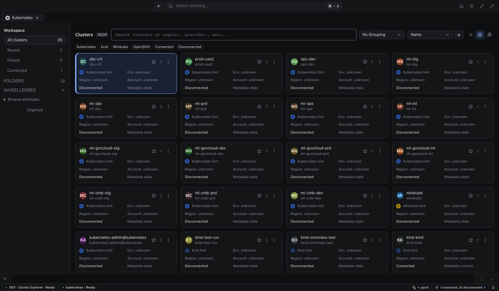
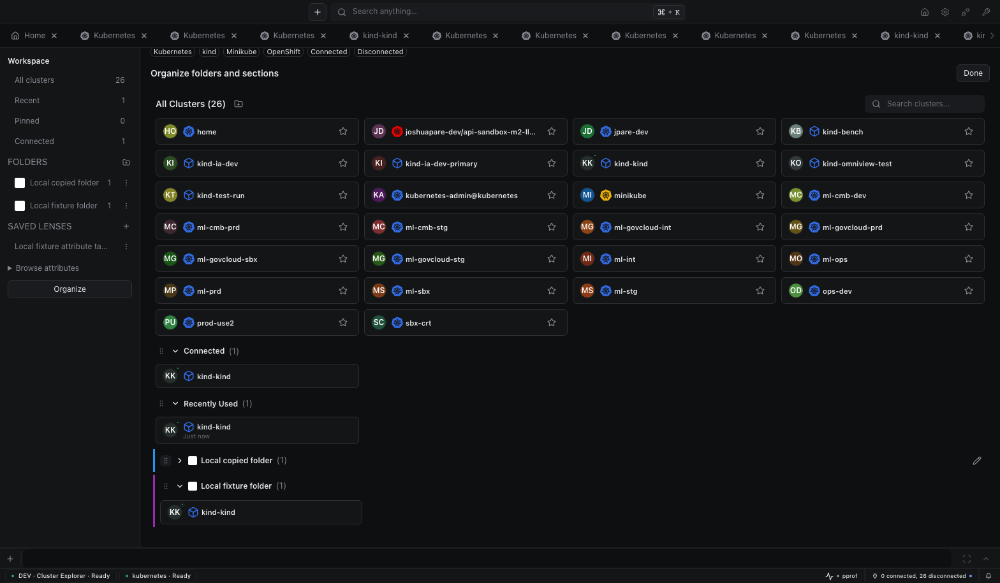

<p align="center">
  
</p>

<h1 align="center">Kubernetes Plugin for Omniview</h1>

<p align="center">
  <strong>A full-featured Kubernetes management experience, built natively into Omniview.</strong>
</p>

<p align="center">
  <a href="https://omniview.dev"></a>
  
  
  
</p>

---

Browse, inspect, edit, and manage Kubernetes clusters without leaving Omniview. The Kubernetes plugin provides real-time resource tables, an integrated terminal, log streaming, port forwarding, Helm chart management, cluster metrics, and full YAML editing — all from a single, unified interface.

Resource icons come from the upstream [Kubernetes Icons Set](https://github.com/kubernetes/community/tree/aeee117fa02e25b68298999d699fb45bdc91acb7/icons), bundled under Apache-2.0. Source attribution and license live in `ui/src/icons/kubernetes/NOTICE` and `LICENSE`. The plugin registers one `ResourceIconSetV1` at `omniview/resource/icons`; both sidebar layouts and the host search palette reuse it. Icons use exact native logical Types, independent of served API version. Unknown resources and custom groups use the host fallback.

Native artwork is adapted to monochrome resource glyphs without blue badges and uses inherited `currentColor` in every theme. Trusted bundled SVG geometry is imported inline, so sidebar and search icons need no image requests or cross-origin asset URLs. Sanitized assets contain no scripts, embedded HTML, external references, or style URLs; regression tests enforce the geometry and attribute allowlists. Modification details remain in `NOTICE`.

Buttons and labeled selection controls use the host's shared Base UI control
language: quiet decorative chrome, consistent neutral fills, and distinct
keyboard focus and selection feedback. Avoid plugin-local border or color
overrides. The [shared design language](https://github.com/omniviewdev/ui/blob/main/docs/THEMING.md#native-control-language)
documents measured contrast, nested themes, and screenshots.

Cluster avatar initials tolerate leading, trailing, and repeated whitespace or
dash separators while a display name is being edited. Whitespace-only names use
`NA`; the display name itself is not normalized or changed.

Pod detail metrics use host-owned observations with canonical resource references
and access routes. Metrics-server provides current CPU (cores) and memory working
set (bytes), not historical series. The Metrics view explicitly marks native
history unsupported while keeping genuine Prometheus history separate. Missing
samples and unknown capacities are never rendered as zero or inferred limits.
Pod totals are not attributed to individual containers; container resource cards
show only configured requests and limits. Source details distinguish UID-verified
samples from name-scoped measurements.

Metric selection, display, layout, details, and absolute or relative time choices
persist in host profile preferences for the plugin and resource type. Revision
checks protect concurrent writes, and save failures remain visible in the view.

## Production notification compatibility

Plugin notifications use the runtime's `useNotifications` API, not its retired
`useSnackbar` export. In the affected production artifact,
`entry2.js:332:197118` maps to `ClustersPage.tsx:58` calling `useSnackbar`;
its runtime setter assigns that missing export to the minified name `zs`.
The desktop host no longer exports it, so opening the cluster list failed
before any connection request. Current plugin source already uses the supported
notification API; older packaged plugins must be rebuilt and replaced.

The release workflow builds through `hack/package.sh`. The affected release's
frozen dependency typecheck accepted the older runtime API, while component
tests mocked that API. Neither check exercised the actual desktop's shared
runtime namespace. The UI build now also inspects the emitted `System.register`
runtime setters and rejects the retired notification import before packaging.
This targeted artifact check does not prove compatibility with every desktop
API or replace an installed-host render smoke test.

Run the guard regressions with
`node --test ui/scripts/check-runtime-imports.test.mjs`. After a UI build, inspect
its assets with `node ui/scripts/check-runtime-imports.mjs ui/dist/assets`.
Before publishing, install the packaged plugin in the intended desktop release,
open the cluster list, create and delete a folder, open cluster resources, and
trigger a resource-link resolution error. Confirm notifications appear and
navigation remains usable after a child-route render failure. Host-owned route
boundaries isolate child pages; the plugin does not duplicate those boundaries.

## Cluster explorer

Cluster explorer search supports free text and `region:`, `provider:`, `env:`,
`account:`, `status:`, `tag:`, and available attribute keys. Repeat one key to
match any value; combine different keys to require every field. Quote literal
identifiers containing colons, for example `"arn:aws:eks:cluster"`. Unknown keys
and unfinished quotes show diagnostics and do not silently widen results.
Displayed region, account, project, and environment facts retain their source.
Explicit user tags take precedence over current metadata, followed by configured
label/data hints; mutable AWS/GCP configuration metadata remains a labeled hint,
not verified infrastructure ownership. Cluster names never establish production
or local facts. Metadata freshness is separate from connection readiness and
workload health. The ready cluster resource route records each mounted view once
in the shared backend-backed, 100-entry recent history, covering homepage,
explorer, launcher, tabs and windows. Nested resource navigation does not add
accesses; reconnecting or opening another ready view does. Failed connections,
failed window creation and connect-only actions do not add accesses.

The primary card or row action opens the cluster. Use the independent action menu for Preview, cluster Settings, and opening another tab or window. Search combines keyed completion with result selection: completion owns the arrow keys while its popup is open; otherwise arrows select a cluster and Enter opens it.

Long cluster names remain available in accessible names and full-name tooltips without changing the card height. Opaque context IDs stay literal identifiers, including colons and slashes; quote them when searching. Keyboard users can open results, use action menus, assign folders, and cancel drag operations without relying on pointer-only controls.

Cards, Table, Debug, and Organize share the same scope and filters. Table includes account or project identity without dropping available project facts. Debug separates connection readiness, metadata freshness, and unknown workload health.

Folders retain preset icons, colors, legacy custom images, manual membership, and automatic rules. Effective membership is the deduplicated union of manual assignments and rule matches. Dragging into a folder adds manual membership; explicit menu actions provide keyboard alternatives. Cancelled and no-target drops leave membership unchanged.

The icon-only folder changer opens a searchable picker with reusable named images. Browse and drop share validation for PNG, JPEG, and WebP files up to 5 MiB; accepted images are normalized to PNG within 128×128 before profile-backed storage. SVG is not imported. Removing a library image preserves its appearance on folders already using it.

Saved lenses retain query, facets, scope, grouping, sort, and view. Folders, assets, lens order, and shared recent history persist in backend plugin data rather than depending on one browser window.

### Actual IDE evidence





These are unmodified captures from the running development IDE, not mockups or packaged-desktop screenshots. The owned fixture exposes a real Kubernetes API and etcd with four namespaces, zero Nodes, and no scheduler. All 26 context aliases point to that one fixture; cloud-like names and configured provider hints do not prove a cloud fleet, production ownership, workload health, or cloud connectivity.

The [evidence index](docs/images/cluster-explorer/index.json) links all twelve final Cards/Table/Debug captures at 360, 768, 1063, and 1568 pixels, organization and search captures, settled API views, restart snapshots, and the live scenario summary. Nine themes, five text scales, both densities, keyboard actions, direct opening, new-tab handoff, folder assets, lenses, and shared recents were exercised. Native OS window creation was not proved.

Kubernetes plugin 0.16.1 requires Omniview 0.30.0 or newer, runtime/Vite 0.30.0, Base UI 0.14.0, and Editors 6.1.8. This cohort supplies activity, structured notifications, and the plugin-data snapshot and compare-and-swap bindings used by the explorer. Upgrade the desktop before installing the plugin; older runtime packages with a Base UI `~0.13.0` peer are incompatible even if workspace source links resolve imports. Omniview 0.30.1 adds plugin-route render isolation.

Container log requests with an explicit `SinceTime` use that timestamp instead
of `SinceSeconds`. Kubernetes accepts only one time filter per log request.

Standalone release 0.15.1 used SDK 0.14.6 for completed-source handling with stock grpc-go. Historical live explorer evidence used SDK `6ce85c8b42cab1547396217510196b29e63ffe55`; it does not establish evidence for this candidate or the integrated activity release.

Standalone release 0.16.0 packaging uses published SDK `v0.15.0` and the SDK-compatible grpc-go fork for activity streams and completed-source handling.

This source candidate pins SDK `v0.15.0` (`427ef1da1f1d`),
including completed-source handling and the C04 source-session wire contract.
It replaces grpc-go with the scoped Omniview fork required by source sessions.

## MCP resource actions

The resource catalog exposes unary `rollout-restart` actions for Deployments, StatefulSets and
DaemonSets. The existing streaming `restart` action remains available to the UI. CronJobs expose
`trigger`, `suspend` and `resume`; triggered Jobs use a controller owner reference to the CronJob.

Streaming restarts publish typed activity progress and completion alongside validated business
output. Notifications show updated, ready, and old replica or node counts against the actual
desired count; zero desired units remain indeterminate. Completion requires the controller to
observe the patched generation; StatefulSets also require matching current and update revisions.
Watch errors, deletion, and closed watches fail observation rather than report success.
The producer adds no guessed resource-navigation target; host-provided actions remain host-owned.

Node `cordon` and `uncordon` remain finite actions. Node `drain` requires streaming execution
and publishes typed activity stages and removed, remaining, and skipped pod counts.
Drain cordons first and completes only after the selected pod incarnations disappear, not when
evictions are accepted. Mirror pods, completed pods, and optionally DaemonSet pods are skipped.
The Node drain confirmation warns that evicting pods permanently deletes their emptyDir data.
Setting `deleteEmptyDirData` to false refuses selected pods with emptyDir volumes.
Grace defaults to 30 seconds; -1 preserves each pod's native termination grace period.
Eviction rejection fails the activity unless explicit force deletion succeeds. Drain does not
retry PDB rejection. Cancellation and observation errors fail without uncordoning or rollback.
Node replacement stops execution; pod UID preconditions protect replacement pods from mutation.

Pods expose a one-shot, non-TTY `exec` action. Its input contains a command array, an optional
container and a timeout from 1 to 100 seconds (30 seconds by default). Each output stream keeps
at most 256 KiB. Invalid UTF-8 bytes become replacement characters. The remote command can
continue after a timeout. Explicit container selection currently supports regular containers only.

Native resource types, including custom resources without specialized helpers, expose Kubernetes
events. Catalog types without native event retrieval return `UNSUPPORTED`. Kubernetes exports
catalog, get, enumerate, and update access for the five Flux toolkit API groups to consumers with
matching connection requirements. The host enforces the grant and existing connection policy;
credentials and native clients remain in the Kubernetes plugin. Core resources, including Secrets,
are not exported through this grant. Flux-specific actions remain in the Flux plugin.

## Table column workspace

Tables opt into a searchable **Columns** workspace through their resource view. Browse
Fields, Labels, Annotations, or Selected; the Selected pane stays visible while
you browse. Search matches full column names and metadata keys across groups.
Checkboxes and remove buttons apply changes immediately, while required columns
remain locked. Select results and Clear affect only the current results.
Reset restores the table's default fields and removes metadata columns.
Field and metadata selections retain their existing persisted settings.

Resource views opt in with `ResourceTable`'s `columnPicker` component slot. The Pod
view supplies `ColumnPicker`; the shared table and toolbar do not inspect resource
keys or kinds to choose UI. Views without an opt-in retain the standard picker.
The picker receives the owner's immutable `columnVisibility` snapshot. Column
handles stay stable across updates, so their getters alone do not form a reactive
input for memoized UI.
Columns that cannot be hidden and are visible by default remain visible over saved
preferences. Optional columns retain their existing preferences.

## Creating and editing resources

Create and edit use the same compact resource editor. The original Pod,
Deployment, StatefulSet, Service, Ingress, ConfigMap, Secret, and
PersistentVolumeClaim forms remain available alongside API-group editor providers
for the native baseline and selected ecosystem APIs. Providers match exact
discovered group, version, kind, resource, and scope; installing a form does not
install its CRDs or grant authorization. Request-only and controller-owned APIs
use their appropriate action or inspection flow.

The Form/YAML switch appears only when a compatible form is available. Other
resources retain the same frame and an honest source fallback, without an empty
form switch. Unsupported versions and fields remain intact for API admission.

The expanded editor-provider catalog requires Omniview 0.24.0 or newer and the
matching runtime/Vite-plugin package cohort. Update the desktop application before
installing Kubernetes plugin 0.14.0.

Nonsecret Form and YAML views edit one document. Controls patch individual AST
nodes, preserving unsupported fields, comments, omitted defaults, sibling fields,
and exact integers. YAML changes appear in supported form fields. Invalid or
unsafe source remains intact in YAML, never regenerated from a partial form.
Unquoted numeric PVC quantities stay YAML-only to preserve their original spelling.
Pending, uncommitted form inputs block submission and mode changes until repaired
or canceled.

**Secret YAML starts as a read-only, redacted projection**, never a mutation
source. Credentials, annotation values, comments, and unknown fields are excluded
from the projection. Explicit confirmation enables raw YAML editing, including
unsupported Secret types and invalid source that needs repair. Raw editing uses a
separate editor model. Hiding it or leaving the view remasks without discarding
source edits; diffs always remain redacted and read-only.

Existing credentials remain unchanged until explicit replacement or removal.
Reveal does not modify the draft; cancel restores only the selected key,
including its original encoding and AST metadata. API errors do not display
credential material. Secret values and raw-edit consent are never persisted as
preferences.

The last explicitly selected mode is remembered in the user's local browser
profile across resources, create/edit views, submit, and cancel. Temporary YAML
fallbacks and diff previews do not overwrite that preference. A single selected
table namespace preselects the creation destination; all/multiple selections
require an explicit namespace.

Forms cover metadata, containers, images, ports, CPU/memory requests and limits,
environment variables, controller replicas, Deployment strategy, and StatefulSet
claim templates and mounts. Secret/ConfigMap environment references remain
unchanged and are edited in YAML. Editing locks resource identity and immutable
fields: existing Pod forms permit image and metadata changes, while StatefulSet
claim templates and governing Service names remain locked. Native API admission
remains authoritative.

Service controls distinguish numeric and named target ports, headless discovery,
DNS aliases, selectors, and external exposure. Ingress routes retain independent
hosts and use same-namespace Service port lookups; unresolved names remain
editable. TLS stores existing Secret references and hostname tokens without
fetching Secret bodies or promising certificate validity.

ConfigMap entries preserve exact text, whitespace, and explicit binary upload
bytes. Secret forms support Opaque, TLS, and Docker credentials with masked inputs
and explicit discard/replacement confirmations. Immutable data stays locked.
PVC controls distinguish default, explicitly classless, and named StorageClasses; preserve exact
capacity through unit changes; and prevent shrinking. Guided expansion requires
actual StorageClass permission; unknown permissions remain an API-validated YAML
operation. No companion workloads, certificates, DNS records, or volumes are
silently created.

Creation and editing retain original mutation routing, incarnation, and revision
safeguards. Failed requests preserve the draft. Passive refresh cannot discard
local form input or replace the optimistic revision after interaction begins.
A changed name or namespace cannot retarget an edit. Native dialogs own their
portaled menus, help, and confirmations,
so these controls remain visible and interactive inside the browser's top layer.

## Frontend CI

Every pull request installs UI dependencies from the frozen lockfile, then runs
lint, native TypeScript checking, tests, the New York age-clock test, and the
production UI build. Host application E2E and profiling instead use UI packages
from the host lockfile and Kubernetes from the host's `plugins/kubernetes`
gitlink. Their linked SDK checkout matches the commit resolved from the host
`go.mod`.

## Resource v2 boundary

The resource provider uses one `resourcev2` domain and transport. Catalog operations are qualified by an explicit connection, type, and declared scope. Get, bounded enumeration, native queries, create, update, delete, actions, and advisory updates remain independent capabilities. Native label queries declare their language and input schema in the catalog.

Native types use `k8s:<actual-api-group>/<resource>`. The core API group stays empty (`k8s:/pods`), so a custom group named `core` remains distinct (`k8s:core/pods`). Helm uses `helm:releases`, `helm:repositories`, and `helm:charts`; the Polaris audit uses `audit:polaris`. Synthetic types cannot collide with native API groups. Served API versions belong to representation and schema bindings, not logical identity. The catalog retains the UI default and separately declares a managed-field-free model representation. IDs are native object names; namespace is an adapter-declared scope dimension. UID is an optional incarnation, and resourceVersion is an opaque observation or mutation precondition.

Only the host issues authority and row keys. A readable kube-system namespace UID supplies a nonauthoritative `kubernetes.namespace-uid.v1` hint with **connection-local** continuity on native resource Types and cluster-backed Helm releases. Local Helm repositories/charts have no cluster hint and remain isolated and unknown. Hints are Type-qualified, never catalog-wide; endpoints and credentials never establish backing identity.

Finite reads use native client-go operations and source-only continuation tokens. Enumeration keeps unknown totals unknown. The implementation-candidate `omniview.resource-wire-policy.v1` separates 16 MiB resource documents, 32 MiB aggregate frames, and at most 256 records from the host's smaller predicate/projection limits. Resource-only HTTP clients bound decompressed finite responses and each native watch frame before client-go materialization. Their actual SDK connection-generation context also cancels discovery APIs that internally use background contexts. Independent logs, exec, and metrics streams keep their native framing rather than receiving a finite aggregate body cap.

Kubernetes enumeration and label queries request one object per native List, preserving the same limit across Kubernetes continuation tokens. Each public page combines native Lists up to the requested page size and wire budget; when the next object does not fit, its input continuation is retained for the next page. A server that ignores the limit can return a complete unpaginated list only when the entire list fits; otherwise acquisition fails without truncation. Paginated servers cost one List request per object, plus a repeat at wire-budget boundaries. Cursors bind the request and connection generation, expired continuations require a fresh acquisition, and an individually oversized object fails with `RESOURCE_LIMIT`.

Resource tables, namespace selectors, repository chart drawers, and native dashboard adapters request `collection: true`. The runtime follows bounded source pages in the background and exposes the full acquired collection; source cursors are transport details, not UI navigation. Searches, filters, sorting, selections, and dashboard counts operate across that collection. Table selections use host record keys in one collection-wide selection state, reset when the target context changes. Unknown source totals remain unknown, and collection acquisition does not strengthen best-effort consistency.

Workload cards open the same canonical resource tables as the sidebar and search, preserving the selected connection. Metadata fields and collection health badges wrap independently on narrower views instead of overlapping. Dashboards and namespace selectors show no source-page controls.

Collection acquisition exposes loading and errors with an explicit retry action. Retry reacquires the failed catalog, target resolution, or collection stage. Changing target, scope, representation, route, plugin, or catalog identity must not mix records or selection from different target contexts.

Repository chart drawers resolve the selected native repository before background pagination through the chart Type's declared `repository` query dimension. Chart identity remains `helm:charts` with native opaque ID and only `domain=helm-client` identity scope; repository is not another identity field. Only configured repository bindings participate, and unrelated indexes are not loaded for a repository-scoped collection.

Valid empty `oneOf` selections for Helm release namespaces, repository domains, or chart repositories return an empty source page before any native or filesystem acquisition. Empty selections never become unscoped queries; pages retain explicit coverage and best-effort consistency without continuation.

Existing informer updates remain explicitly **bestEffort**. Cache readiness does not prove an atomic snapshot, replay, gap-free delivery, or P05 source continuity. Native `{namespace,GVR}` acquisitions are shared only while consumers remain; the final consumer stops the underlying LIST/WATCH and releases its cache. Connection teardown stops all remaining sources.

Watch failures use SDK error codes: unsupported native methods report `UNSUPPORTED`, cache-sync deadlines report `TIMEOUT`, and other unclassified failures report `PROVIDER_ERROR`. Unrepresentable records retain their classified conversion error. These states do not claim source continuity.

OpenAPI documents are bounded to 16 MiB and shared by document reference plus exact local root. Demand-driven catalog refresh runs at most once every 30 seconds per connected cluster, with a 10-second acquisition deadline. Each eligible refresh reacquires OpenAPI before comparing snapshots, so schema-only changes and recovery from an initial missing document can update the catalog. This is not a CRD watcher or immediate change notification.

Before publication, the provider sets `nullable: true` on exactly
`io.k8s.apimachinery.pkg.apis.meta.v1.Time` and
`io.k8s.apimachinery.pkg.apis.meta.v1.MicroTime`.
It preserves the fetched source bytes and resource bodies.
It changes only those component spans in the published document.
The document revision hashes the published bytes; the host digest also reflects the correction.
The correction uses exact `components.schemas` spans, not case-different aliases.
`GetSchemaDocument` serves bytes whose SHA-256 equals the binding revision.
Generic host null checks remain strict.

One provider-wide 32 MiB retained-schema budget covers every connection, with a separate 16 MiB staging bound. Identical document bytes share retained storage. Exhausted entries are unavailable, not incorrectly absent, and resource Get remains independent. Replacement, failed acquisition, and teardown release the cache budget; queued acquisition is cancellable. Available, absent, and unavailable schemas remain distinct; raw OpenAPI transport does not claim P07 normalization or full validation. Editor metadata also forwards installed Helm chart `values.schema.json` roles with native acquisition errors intact. Creation can use a schema-derived template or a complete pasted native manifest.

Helm schema acquisition never grants or requires Helm Secret access for native Pod schemas. A source-specific Helm failure retains native bindings and returns a document-free, generic Helm values role marked unavailable with an optional safe machine-code `unavailableReason`, never backend diagnostics or invented release identities. Request cancellation, deadlines, and retired connection generations remain errors rather than partial success. All Helm metadata, storage, and schema HTTP requests reuse the existing authenticated bounded client.

Tables and navigation use canonical references, routes, target membership, and host keys. Raw tagged integer Values stay exact; display adapters narrow only safe integers to numbers and retain wide integers as `bigint`. Restart counts and image-byte totals preserve exact mixed integer arithmetic. Mutation and action requests retain known UID and revision guards. Native connection discovery, explicit overrides, and disabled routes remain separate; host persistence owns desired profiles, not provider-side kubeconfig edits. Specialized React Router routes retain decoded colons and protect native Type slashes as `%2F`.

Native and Helm resource sidebars and drawer factories register through `extensionRegistrations` at `omniview/resource/sidebar/infopanel` and `omniview/resource/drawer`. Exact `{pluginId, resourceKey}` metadata selects each opaque logical Type without parsing its spelling. Standard views and shared actions are identical for table and linked-resource drawers; the supported default drawer factory remains available for CRDs and other dynamically discovered resources without a dedicated sidebar.

Standard resource YAML drawers submit through the resource-v2 mutation hook using the original contextual route, reference, known incarnation, and observed revision. The editor requires catalog-advertised `mutationUpdate` support for the exact scope; the catalog's `update` capability describes advisory watch updates, not writes. Missing identity, unavailable catalog metadata, and non-mutating resources cannot submit. YAML integers retain their exact values through tagged Value conversion. Pending writes reject duplicate submits, parse and native failures retain the draft, and only a successful native mutation replaces the dirty baseline with the returned record. Target/reference changes retire the old editor state, so late results cannot overwrite another resource. Successful writes use the runtime's canonical resource-query invalidation.

Relationship resolution receives one canonical source Get and explicit host-admitted target bindings. Native links use the matching target Type, scope, route, and authority; source authority never substitutes for another Type. Missing or out-of-scope bindings fail explicitly, and overlapping bindings reject admission. Native acquisition failures remain errors rather than complete empty relationships. Resolvers follow observed references and native ownership, not an all-Type inventory scan.

Relationship declaration membership uses the complete route catalog, including Helm and audit types, rather than only discovered Kubernetes API bindings. Catalogued types without declarations return an empty declaration set; unknown types still fail with `NOT_FOUND`. Connection-generation leasing remains required for all metadata reads.

Native object-reference links use exact catalog bindings by observed API group and kind, never legacy GVK tokens or guessed plurals. Known core Pod endpoint references use `k8s:/pods` independently of OpenAPI availability, including the controller shape with omitted API version and known UID. Namespaces and known incarnations remain guarded; incomplete, ambiguous, or unavailable bindings stay explicitly unresolved.

Resource-scoped terminals, logs, metrics, and port forwarding carry original tagged Values plus actual canonical references and routes, never decoded display objects. Built-in stream selectors check supplied observations against the explicit matching route, provider, Type, scope, name, and known UID without acquiring another target Get permission. Fresh external Pod shells additionally verify the authoritative Pod with Get, as described under Integrated Terminal. Neither body data nor a reference grants authorization. Pod and Node terminals retain native container/command behavior; PATCH-only node cordon/uncordon keep their native permissions and atomic UID guards. Native utility stream engines remain unchanged. Per-connection Prometheus overrides use string query parameters (`prometheus_service_name`, `prometheus_service_namespace`, `prometheus_service_port`), not fabricated observation fields. Ordinary cluster metrics omit resource intent.

The Kubernetes API, network, and certificate error classifier preserves native causes for local inspection but exposes only fixed, public-safe classification messages. Server messages, endpoints, network diagnostics, and certificate details stay in the wrapped cause, not this classifier's public error fields or serialized error text. The resource gRPC transport independently preserves its existing sanitization; asynchronous logs use a separate event path and are not covered by this classifier guarantee.

Metric queries and subscriptions use the SDK's sole connected-generation lease, never a stopped profile or first-connection fallback. Canonical connection retirement evicts native metric clients, detection results, proxy-failure state, and SPDY tunnels; pending work cannot publish into a later generation, and unrelated connections remain active. Helm configurations are operation-local rather than cached: HTTP-only Helm clients reuse the existing bounded TLS/exec/EKS transport, merging RPC cancellation with the source connection lifetime without mutating shared clients or reimplementing Helm storage.

Native logs borrow a streaming client constructed once alongside each resource connection generation, from the same configured TLS/exec/EKS transport. The streaming client does not use finite resource-response buffering: both emitting and silent follow streams return after HTTP headers, before body completion. Log readers and source watchers retain the SDK's sole generation lease until closure or cancellation. Retirement cancels active streams before destroying their client and closing idle transport connections. Finite resource and JSON watch budgets remain unchanged; finite log limits remain in the log adapter.

The old mandatory CRUD/Find registration generator, public resource DTO stack, and duplicate `get_resource`, `list_resources`, `delete_resource`, `list_namespaces`, and `get_pod_logs` custom tools are retired. Kubernetes no longer registers a standalone tools capability or constructs a separate resource-tool client stack. The host generates MCP resource tools from the admitted route catalog, negotiates namespace values through scope discovery, and consumes bounded native log sessions through the existing resource controller. Shared native utilities remain available to their other consumers.

The replacement resource path retains native label selectors, every served API version, and the declared managed-field-free model projection without changing the UI default. Omitted list namespace selects the admitted all-namespace scope; namespaced Get/delete require a namespace and cannot widen configured restrictions. Native pages remain capped at 256 items while the host can collect up to 500 with truthful continuation metadata. Delete sends observed UID and resourceVersion preconditions. Finite pod logs default to 200 tail lines, clamp at 5,000, and cap output at 1 MiB; omitted container selection is delegated to Kubernetes, not promised to mean the first container. Logs do not add a hidden Pod Get requirement.

The owned kind/history audit fixture below is unchanged. Helm release enumeration is bounded through native Secret/ConfigMap storage; other Helm storage drivers are not advertised as bounded enumeration sources.

Node drain accepts `gracePeriodSeconds: -1` to leave Kubernetes eviction grace unset, preserving each pod's native termination grace period. The drawer sends that sentinel explicitly. Omitting the parameter retains the 30-second action default; zero requests immediate termination, nonnegative integers override the grace period, and all other negative values fail before cordon or eviction.

## Resource event and table performance

Informer updates with the same nonempty resource version and the same UID, name,
namespace, API version, and kind now stop before JSON encoding and watch delivery.
Changed or empty versions and identity replacements still emit updates. Initial
ADD replay remains intact.

Resource tables discover label and annotation columns from their existing
unfiltered resource result, without another resource subscription. Existing
per-resource storage keys remain shared across connections. New keys start
unselected; updates with no new keys preserve selection state and write nothing
to localStorage. Combined table columns retain their reference until inputs change.

Dashboard events now render a measured, overscanned viewport rather than mounting
every event. Filtering, search, warning counts, ordering, and object links still
cover the full event collection. The overview owns its Pod subscription and passes
its namespace-filtered result to the Pod summary card, avoiding duplicate live
event delivery and cache application. Initial List calls were already query-deduplicated.
Namespace scope changes reset the event viewport to its newest entries; live
updates preserve the current viewport. CI also runs age-clock tests explicitly
under `America/New_York` to enforce DST boundary coverage.

Age cells share one visibility-aware scheduler per renderer package. They preserve
second/minute/day formatting, stop while the document is hidden, refresh on resume,
and remove the final timer and visibility listener on unmount. Pod metrics acquire
only when CPU or memory columns are visible in a visible document. Persisted column
visibility applies before the observer mounts; pausing the observer does not
remount table rows or discard selection, filtering, focus, or scroll. Dashboard
metric consumers also pause while the document is hidden.
Pod and Node tables discover current-value metric columns from the admitted source
catalog. Custom columns start hidden and appear in the column picker without a
Kubernetes plugin rebuild. Visible metric columns contribute to one shared host
observation over mounted rows; cells never fetch. Catalog and observation use the
same durable source choice, including explicit native or external selection.
The single visible clock also checks wall-clock and time-zone changes once per
second, refreshing old labels after clock corrections without formatting them
on ordinary young-cell ticks.

Synthetic provider measurements for 300 representative pods: unchanged replay
0.054 ms, zero encoded bytes and allocations; changed updates 7.442 ms,
1,453,200 encoded bytes and approximately 6.63 MB allocations. These are different
workloads on the new handler, not a native before/after CPU comparison. Warm
informer List still serializes complete objects: 300 pods took 8.132 ms and
1,452,900 bytes; 3,000 took 75.024 ms and 14,529,000 bytes with fake clients.

These changes reduce provable event and storage work. They do not establish a
reduction in the reported 53.5% Graphics and Media / 35.6% WebContent CPU on a
300-pod connection. Native acceptance requires matched cluster, viewport, event
rate, warmup, and repeated dashboard/table/hidden-view captures.

Remaining work includes generalized single-owner ingestion, bounded transport,
projected resource representations, and source paging with complete query
membership and sorting. Event virtualization bounds mounted DOM, not event
acquisition, deduplication, or sorting. Do not truncate results or remove initial
ADD replay without proving List/watch handoff correctness. The
[performance tracker](https://github.com/omniviewdev/omniview/issues/212) links
agent-ready work, measured receipts, and SDK-v2 carry-forward requirements.
[FreeLens watch ownership](https://github.com/freelensapp/freelens/blob/0c8f34ac6c5fe6546e25c7591abe335c8ca2b689/packages/core/src/renderer/kube-watch-api/kube-watch-api.ts#L107-L196)
and its [virtual list](https://github.com/freelensapp/freelens/blob/0c8f34ac6c5fe6546e25c7591abe335c8ca2b689/packages/core/src/renderer/components/virtual-list/virtual-list.tsx#L46-L123)
provide source references, not measured performance parity.

Regression checks:

```bash
cd ui
pnpm exec vitest run src/components/tables/ColumnFilter/useDynamicResourceColumns.test.tsx
pnpm exec vitest run src/utils/ageClock.test.tsx src/components/kubernetes/table/shared/TableMetrics.test.tsx src/components/shared/table/ResourceTable/index.test.tsx
AGE_CLOCK_BENCH=1 pnpm exec vitest run src/components/kubernetes/table/shared/cells/AgeCell.benchmark.test.tsx --silent=false --reporter=verbose
cd ..
GOWORK=off GOFLAGS= go test ./pkg/plugin/resource/resourcers -count=1
GOWORK=off GOFLAGS= go test ./pkg/plugin/resource/resourcers -run '^$' -bench 'Benchmark(MakeEventHandler|Base_ListRepresentativePods)' -benchmem
```

The hook regression includes a zero-storage-write smoke check for unchanged keys
and empty results. Release 0.8.1 consumes the published runtime 0.9.1 reducer fix
through the `~0.9.1` dependency range and its matching pnpm lock entry.

The opt-in age benchmark mounts 300 and 3,000 real cells with controlled time;
its counters are not native CPU measurements. `AGE_CLOCK_BASELINE=1` requires
preserved pre-change cell source and asserts its old timer behavior, so it cannot
silently label the current implementation as the baseline. Storybook
`Dashboard/EventsTable` fixtures `Viewport300`, `Viewport3000`, and `Viewport30000`
exercise bounded mounting, final-item search, keyboard scrolling, varying row
heights, resizing, reordering, loading, and empty transitions.

## Connection route encoding

Cluster IDs are opaque values, including EKS ARNs containing `/`. Encode the ID with `encodeURIComponent` whenever constructing `/cluster/:id` links, including resource navigation, dashboard shortcuts, and connection settings. React Router returns decoded parameters; encode them again when constructing a new URL. Do not encode the entire path or decode an ID before inserting it into a path.

## Connection readiness

The resource route subtree uses the shared runtime `ConnectionBoundary`, so direct URLs, history, search, and sidebar navigation cannot mount resource hooks before the connection is ready. Navigation does not connect automatically: use **Connect and continue** to start the connection and resume the exact destination. Cluster selection and connection editing remain available offline.

Connection failures offer retry and credential-edit recovery. A disconnect removes protected resource content; watch progress and individual resource permission errors remain separate from connection readiness. The host protects detached resource drawers using the same runtime boundary.

Cluster connect and disconnect failures use the runtime's single structured error notification. Hub, grid, and list actions consume the rejected lifecycle promise without adding a second raw JSON notice. Returned unsuccessful connection statuses still show their existing warnings, failed starts do not navigate, and row loading indicators clear after settlement. Unrelated errors, such as clipboard failures, keep their own notifications.

The splash shows the saved cluster identity while checking, connecting, or recovering: avatar, provider, display name and description, context, auth-user name, kubeconfig path, and full connection ID. Display overrides are honored. Metadata loads independently without connecting; a missing or failed metadata read leaves the route ID and recovery controls visible. Credential contents and arbitrary metadata are not displayed. Successful connection replaces the splash with the requested resources.

Storybook's **Connections/ConnectionBoundary** stories provide mocked loading, disconnected, connecting, authorization, missing-connection, and error states, including metadata loading/failure. Interactive recovery opens a mocked Pod table instead of a redundant connected splash. The preview makes no backend connection requests.

Kubernetes plugin 0.13.0 requires Omniview 0.19.0 or later for native Pod exec and pins the published `@omniviewdev/runtime` and `@omniviewdev/vite-plugin` 0.19.0 cohort with `@omniviewdev/base-ui` 0.10.0 and `@omniviewdev/editors` 6.1.3. Native-command planning uses SDK 0.12.0. The shared TreeList contract is available in Omniview 0.17.0 or later. Profiling support was introduced in SDK 0.11.0 and stays off by default. Historical plugin 0.12.0 retains the 0.14.0 UI/runtime cohort and requires Omniview 0.15.0 for profiling controls; 0.11.0 requires Omniview 0.14.0 for transactional settings; 0.10.0 requires Omniview 0.13.0 for connection/server metadata; 0.9.0 requires Omniview 0.12.0 for resource-v2 integration and collection-wide views, and 0.8.2 uses its older compatible producer cohort.

## Plugin-process profiling

Profiling is off by default. In Omniview 0.15.0 or later, enable plugin profiling in the developer settings, save, and restart the Kubernetes plugin. Capture CPU, heap, or Go execution traces from the plugin process, not the desktop host or Kubernetes workloads. Disabling profiling also requires saving and restarting the plugin; the old endpoint closes when the process stops.

The SDK serves profiling on a loopback-only endpoint. Treat profile files as sensitive process data; do not expose the endpoint or publish captures containing private data.

## Connection/server metadata

The resource provider publishes core server facts through the optional SDK `connectionMetadata` trait:

| Key                          | Source                                                       |
| ---------------------------- | ------------------------------------------------------------ |
| `kubernetes.server_url`      | Resolved REST endpoint, without userinfo, query, or fragment |
| `kubernetes.server_version`  | `/version.gitVersion`                                        |
| `kubernetes.server_platform` | `/version.platform`                                          |

Optional environment hints reuse connection configuration, the resolved endpoint, and the existing version response:

| Keys                                                        | Meaning                                                                                                      |
| ----------------------------------------------------------- | ------------------------------------------------------------------------------------------------------------ |
| `kubernetes.provider`, `kubernetes.provider_source`         | Recognized environment and its inference source: `connection_config`, `server_endpoint`, or `server_version` |
| `kubernetes.distribution`, `kubernetes.distribution_source` | Recognized server build distribution, separate from hosting                                                  |
| `cloud.provider`                                            | AWS, GCP, or Azure hint                                                                                      |
| `aws.region`, `aws.account_id`                              | Region and account; account comes only from a valid configured EKS cluster ARN, never an authentication role |
| `gcp.region`, `gcp.zone`, `gcp.project_id`                  | Configured or recognizable GKE context details                                                               |
| `azure.subscription_id`, `azure.resource_group`             | Configured Azure details                                                                                     |

Unknown optional facts are omitted, and obsolete hints are explicitly removed on refresh. These are display hints, not verified hosting or feature-gating authority. Recognition uses bounded patterns rather than arbitrary display-name substrings. A Docker runtime is not evidence of Docker Desktop, kind, or a cloud provider.

Environment badges and location chips appear in Cluster Info and the compact overview. Provenance is available on hover or keyboard focus; stale hints use amber history indicators. Account/project/subscription identifiers appear only in settings and support copying. The server platform field is labeled **Server OS / architecture** to distinguish it from hosting.

Badges and observation indicators use keyboard-focusable buttons with concise names. Tooltips provide accessible descriptions without repeating the full provenance in the control name.

The metadata callback makes a bounded `/version` request; it does not list Nodes or other resources. Overview and Cluster Info read the shared runtime metadata store rather than enriched `Connection.Data`. Stop retains stale display values; reconnect observes a new client generation. Metadata never grants resource support or authorization.

Endpoint metadata uses client-go's effective URL normalization, including scheme-less hosts and configuration-based TLS defaults, before removing credentials, query strings, and fragments.

Cluster Info presents a compact server identity panel; overview keeps an inline fact strip. Values remain primary. Clock indicators expose observation times on hover or keyboard focus, amber history indicators identify stale values, and unavailable facts show a dash with their reason in a tooltip. Initial reads use skeletons rather than status prose. Connected Cluster Info offers an explicit refresh action.

The overview's node count uses the full acquired node collection, and health uses the acquired node, pod, and event collections with the selected namespace scope applied to pods and events. API-group counts and resource health remain resource/catalog information, not metadata.

Folder rules use `metadata:<namespaced-key>` for observed facts. Existing endpoint/version/platform rules migrate in memory and persist through normal folder edits. Retired inventory/last-checked rules remain visible for review and do not match, including negative operators. Configuration-backed `data:*` rules retain their existing meaning.

Metadata folder rules read only own string-valued keys. Inherited properties and invalid values remain unknown, including for negative operators.

## Local audit evidence fixture

`hack/history-audit.mjs` creates a separate, randomly named local kind sandbox.
It does not connect Omniview history, provide historical reads, or resolve the
blocked production query/evaluator gates.

Requirements: Node.js 26.13.0, `kubectl` compatible with Kubernetes 1.32, kind
**v0.27.0**, and a running local Docker engine using a Unix-socket Docker context.
Unset `DOCKER_HOST` and `DOCKER_CONTEXT`; remote Docker endpoints are refused.
Docker must permit bind mounts from the chosen directory. The node image is
`kindest/node:v1.32.2@sha256:f226345927d7e348497136874b6d207e0b32cc52154ad8323129352923a3142f`,
published for amd64 and arm64 in the
[kind v0.27.0 release](https://github.com/kubernetes-sigs/kind/releases/tag/v0.27.0).
Initial setup may download this image and kind's standard system images.
No fixture workload or external application image is needed.

Run from this repository. Choose an absolute, canonical path whose final directory
does **not** exist; do not use a symlinked parent (`/tmp` is symlinked on macOS).
For example, use a new directory below your real home directory:

```bash
SANDBOX="$HOME/omniview-history-audit-smoke"
node hack/history-audit.mjs create "$SANDBOX"
node hack/history-audit.mjs exercise "$SANDBOX"
node hack/history-audit.mjs inspect "$SANDBOX"
node hack/history-audit.mjs delete "$SANDBOX"
node --test hack/history-audit.test.mjs
```

Creation prints the generated name, private kubeconfig path, and explicit context.
Every cluster operation uses that kubeconfig/context, never the user's kubeconfig
or current cluster. Existing directories/clusters are never adopted. Ownership
checks require the exact kind label, sandbox host mount, and recorded container ID.
The private directory contains credentials: do not upload or commit it.

Exercise runs once per fresh sandbox. It performs ConfigMap create, patch, server
dry-run, RBAC-denied create, delete, and recreate, and asserts distinct incarnation
UIDs. It also creates a core Event, a namespaced custom resource with an explicit
CRD, and a status-subresource patch. Synthetic Secret and TokenReview probes check
the metadata-only boundary. CRD creation itself is metadata-only.

The mounted `audit/audit.jsonl` contains actual API-server audit events. The policy
captures RequestResponse only for fixture-namespace ConfigMap, Event, and Sample
writes. Secret, authentication, authorization, other namespaces, and other resources
remain metadata-only. `RequestReceived` is omitted. Inspect rejects malformed JSONL,
unexpected RequestReceived events, and bodies outside the allowlist; its evidence
lists audit IDs, stages, HTTP outcomes, request URIs (including dry-run), and UIDs.
Compare completed ConfigMap create UIDs with `exercise.json`; look for a 403 denied
request, a `dryRun=All` URI, and the Sample status patch. Synthetic unit-test audit
records are not real-cluster evidence.

Subprocess deadlines, output caps, and a 24 MiB inspection limit bound local work.
The audit log rotates at 20 MiB with one backup; inspect reads only the active file,
so run it promptly after exercise. This fixture does not prove durable retention,
watch ingestion, historical authorization, numeric query safety, or host history.
An interrupted create retains its sandbox and any partial cluster for explicit
cleanup. Run `delete` with the same directory; it refuses unknown/replaced containers
and retains evidence. A failure before a container exists leaves only local files.
After deletion, archive desired evidence, then remove the private directory yourself.

## Highlights

- **70+ resource types** across every major Kubernetes API group, with automatic discovery of Custom Resource Definitions
- **Real-time sync** via Kubernetes informers — resources update live as your cluster changes
- **Integrated terminal** — exec into any pod container, with intelligent shell detection for distroless images
- **Log streaming** — tail container logs with follow mode, timestamps, and multi-container support
- **Port forwarding** — forward pod ports to your local machine in one click
- **Helm management** — browse charts, install releases, manage repositories, and upgrade deployments
- **Cluster dashboard** — health overview, live CPU/memory metrics, workload summaries, and event feeds
- **YAML editor** — Monaco-powered editor with schema validation for creating and editing resources
- **CIS benchmarks** — built-in security compliance scoring for your clusters

## Capabilities

| Capability     | Description                                                               |
| -------------- | ------------------------------------------------------------------------- |
| **Resource**   | Browse, create, edit, and delete any Kubernetes resource                  |
| **Exec**       | Open an interactive shell in pod or node containers                       |
| **Logs**       | Stream and inspect container logs with filtering                          |
| **Networking** | Port-forward from pods to localhost                                       |
| **Metrics**    | CPU, memory, network, and disk metrics from metrics-server and Prometheus |
| **UI**         | Custom tables, sidebars, dashboards, and dialogs                          |

## Supported Resources

<details>
<summary><strong>Core API</strong> <code>v1</code></summary>

Pod, Service, Namespace, Node, ConfigMap, Secret, PersistentVolume, PersistentVolumeClaim, ServiceAccount, Endpoints, Event, LimitRange, ResourceQuota, ReplicationController, PodTemplate, ComponentStatus

</details>

<details>
<summary><strong>Workloads</strong> <code>apps/v1</code> <code>batch/v1</code></summary>

Deployment, StatefulSet, DaemonSet, ReplicaSet, ControllerRevision, Job, CronJob

</details>

<details>
<summary><strong>Networking</strong> <code>networking.k8s.io/v1</code></summary>

Ingress, IngressClass, NetworkPolicy

</details>

<details>
<summary><strong>RBAC</strong> <code>rbac.authorization.k8s.io/v1</code></summary>

Role, ClusterRole, RoleBinding, ClusterRoleBinding

</details>

<details>
<summary><strong>Storage</strong> <code>storage.k8s.io/v1</code></summary>

StorageClass, VolumeAttachment, CSIDriver, CSINode, CSIStorageCapacity

</details>

<details>
<summary><strong>Policy &amp; Scheduling</strong></summary>

PodDisruptionBudget, PriorityClass, HorizontalPodAutoscaler (v1, v2, v2beta2)

</details>

<details>
<summary><strong>Admission, Auth &amp; Discovery</strong></summary>

MutatingWebhookConfiguration, ValidatingWebhookConfiguration, ValidatingAdmissionPolicy, TokenRequest, TokenReview, SubjectAccessReview, EndpointSlice, Lease, FlowSchema, PriorityLevelConfiguration

</details>

<details>
<summary><strong>Extensions</strong></summary>

CustomResourceDefinition, APIService, RuntimeClass, CertificateSigningRequest

</details>

<details>
<summary><strong>Helm</strong> <code>helm/v1</code></summary>

Chart, Release, Repository

</details>

## Feature Overview

### Resource Management

Every resource type gets a dedicated, sortable table with:

- **Global search** across all visible columns
- **Namespace filtering** shared across resource views per connection
- **Column visibility** controls with persistent preferences
- **Resizable columns** with saved widths
- **Dynamic label/annotation columns** — promote any label or annotation to a first-class column
- **Inline create** — open a YAML editor pre-populated with a template for the resource kind
- **Row actions** — click any row to open a detail sidebar with tabs for overview, YAML, events, and more

### Resource Navigation

Both sidebar layouts use the host's shared `TreeList`, with one virtualized scroll viewport, keyboard navigation, and persistent expansion. Arrow keys move focus and expand or collapse groups; Enter or Space activates the focused destination or group. Plugin-contributed parent pages remain navigable.

Expansion stays connection-specific. Sidebar order and edit mode remain global preferences. Unlock the sidebar to reorder sibling items with explicit drag handles, using pointer input or Space, arrow keys, and Space to drop. Items cannot move between sections or parents. Reset restores the default order without clearing expansion.

New API groups and resource kinds appear as the catalog changes. Watch-state badges update independently of the navigation structure; errors take precedence over syncing indicators. Empty categories and unavailable primary resources do not become invalid navigation destinations. Global command search continues to reuse the same destinations.

For the supported frontend cohort, see [Prerequisites](#prerequisites). The host owns the shared component singleton; plugin dependencies do not replace it.

### Scoped Command Search

The runtime provides transactional settings, connection/server metadata, collection-wide resource views, connection-route protection, live-Pod debug recovery, asynchronous resource actions, opening a connection in a new tab or window, and the shared search and resource-icon contracts. Exact standalone dependency pins live in `ui/package.json` and `ui/pnpm-lock.yaml`; the plugin's minor version is independent of the host version.

Cmd/Ctrl-K opens Omniview's single global search surface, including on Kubernetes pages. Type a connection name and press Tab to scope it, then scope a resource type and resource. Enter opens the selected destination or existing action. The sidebar's **Find in this connection** control opens that same surface with a visible connection chip.

Kubernetes routes automatically scope global search to the active connection only, including on Pod and other resource lists. Deeper scopes require explicit Tab selection or an explicit `openGlobalSearch` scope.

Empty-input Backspace selects the final chip; another Backspace removes it. Removing a parent also removes dependent scopes and restores the parent search. Resource results show namespaces and retain UID identity so replaced objects cannot inherit stale actions.

Search reuses the sidebar's destinations and eight connection-scoped recent resource types. **Open list matching …** transfers text into the resource table without changing its namespace, node/controller, or other structured filters. Search scans at most the first 200 objects and reports incomplete results; use the list for broader filtering.

Disconnected connections require explicit connection. Authentication, permission, loading, and source failures remain visible. Logs, container choices, and destructive-action confirmations use the same action inventory as resource menus and drawers, even when no table is mounted.

Resource scopes acquire native live-update subscriptions even when no table is open. Failed acquisition keeps current results visible and offers **Retry live updates**; closing or removing scopes releases their subscriptions. Event bursts preserve rows and selection, including updates received during an in-flight read.

Search and resource views share the runtime's `resourceQueryKeys` snapshots. Query refinements reuse resource data for 15 seconds and readiness for 2 seconds. Action execution still reads and validates the current object instead of trusting the discovery snapshot. A deleted or replaced object is an object failure, not a reconnect suggestion.

### Detail Sidebars

Click any resource row to open a rich sidebar panel with contextual information:

| Resource                                 | Sidebar Highlights                                                                                     |
| ---------------------------------------- | ------------------------------------------------------------------------------------------------------ |
| **Pod**                                  | Container statuses, ports, volumes, environment, probes, resource requests/limits, live metrics graphs |
| **Deployment / StatefulSet / DaemonSet** | Replica status, rollout progress, selector details                                                     |
| **Service**                              | Port mappings, endpoint resolution                                                                     |
| **Ingress**                              | Rule table with host, path, and backend mapping                                                        |
| **Job / CronJob**                        | Completion status, schedule, parallelism                                                               |
| **Node**                                 | System info, capacity, images, topology, conditions, live metrics                                      |
| **Namespace**                            | Resource quotas, pod counts, events                                                                    |
| **ConfigMap / Secret**                   | Key-value viewer                                                                                       |
| **PV / PVC**                             | Binding status, storage details, access modes                                                          |

All sidebars include a **YAML editor** tab with diff view and schema-validated editing.

Resource forms and YAML share a host-owned canonical document. The original eight
native forms use the same editor resolver as contributed forms through
`kubernetes/resource/editor/v1`; contributions do not receive a raw source setter.
Scoped patches are atomic and session/revision-bound. Untouched YAML nodes,
comments, unknown fields, and exact wide integers remain intact. Map omission is
not deletion: forms remove fields explicitly.

Canonical validation errors block submission, not format switching. Uncommitted
input stays in the form until committed or cleared; switching never discards it.

The host owns create identity, locks edit identity and optimistic revision, and
hides Namespace for cluster-scoped APIs. Editor and mode preferences store only
IDs, never manifests or credentials. Sensitive projections cannot be written
back. Raw source and sensitive action results require separate explicit
disclosure and remask on editor, session, mode, or pending-operation changes.
Unknown-resource fallback starts with a protected preview.

Ordinary registered resources show the editable canonical YAML, including unknown
fields and comments. Sensitive registered resources show a useful, read-only full
projection with protected values replaced, never a mutation document. Such
projections omit comments; unknown, unloaded, or crashed editors retain the
protected fallback. Protected paths survive provider replacement within a session.

Both standalone builds and the host's shared Monaco 0.52.2 cohort declare the
word-highlighter promise-ownership backport from [upstream VS Code](https://github.com/microsoft/vscode/blob/e57fbd7a49486f12be089ec5800293f3453eefbd/src/vs/editor/contrib/wordHighlighter/browser/wordHighlighter.ts#L294-L315).
Closing YAML immediately after cursor or Find activity disposes the editor
normally; pending highlight cancellation belongs to its callers, and unexpected
errors still use Monaco's error handler. No feature is disabled or global error
filter installed.

Both Create and Submit prepare the canonical snapshot before mutation, regardless
of Form/YAML mode. This includes pure validation and optional read-only
`validateSubmission` prerequisite checks. A changed session, revision, provider,
or cancelled check cannot commit an earlier snapshot. Domain admission services
cannot execute mutation protocols. Provider unload/crash retains the draft;
pending local input and unavailable required admission must be resolved before
submission. Controller/system inspection never unlocks generic YAML Save.

Submission temporarily locks write callbacks without invalidating completed
read-only reference evidence. A changed query, source revision, session, or
reference service still cancels stale lookups.

Inspectors keep resource values readable without enabling edits. Unavailable
write prerequisites do not block switching an inspector to read-only YAML.

Generator Secret selector names and keys accept public reference metadata as
text. Existing protected references remain write-only; credential subtrees and
unknown sensitive siblings stay opaque and are preserved by leaf updates.

Public webhook, module, monitoring, and event-sink references display only safe,
credential-free values. Unsafe or opaque references remain write-only and are
preserved until explicit leaf replacement.

Image catalogs accept exact canonical major-version integers across Form/YAML
switches while rejecting duplicates, fractions, and unsupported integer ranges.
Read-only Calico numeric projections and Kyverno retry counters also preserve
canonical integers without coercing them through JavaScript `Number`.

**Requests & inspection** in the cluster sidebar opens request-only APIs and
read-only inspectors without pretending they support named-resource creation.
It supports exact discovered resource loading and validated local captures.
Nonpersistent reviews, service-account token requests, discovery, and metric
queries use host-whitelisted transports. Run-now fetches a saved CronJob afresh,
checks Job-create authorization, and opens a separate ordinary Job-create review
without an owner reference.

### Integrated Terminal

Exec into any running container directly from the resource table. The plugin handles:

- Multi-container pods with container selection
- Intelligent shell detection (`bash` > `sh` > `ash`)
- Explicit distroless recovery with targeted ephemeral containers
- Node-level shell access via ephemeral debug pods
- Terminal resize support
- SPDY and WebSocket protocol fallback

On macOS, supported Pod **Exec** menus in both the row and drawer show an explicit
**container — Open in Native Terminal** choice beside each ordinary container's
built-in action. Native choices stay disabled while launching. A successful
launch closes the drawer; a native error leaves it open and never creates a
built-in terminal. Init containers, ephemeral attach, and Node debug shells keep
their existing built-in behavior.

The SDK v0.12.0 native-command capability plans a **fresh external shell** only
for ordinary Pod exec. The host preserves the selected connection, canonical
Pod reference, explicit container, and literal remote command arguments. The
plugin verifies the current Pod UID and ordinary-container membership with a
Kubernetes Get before returning structured `kubectl` arguments. Deleted,
replaced, terminating, or mismatched Pods fail instead of redirecting the shell.
Attach, ephemeral-container sessions, init containers, and Node debug shells do
not support this capability. No PTY state, shell history, or remote working
directory transfers; there is no built-in-session fallback.

Native plans reference the existing local kubeconfig with explicit context and
namespace flags, always enable stdin, and enable TTY only when requested.
`kubectl` must be available locally. Native exec supports reusable static token,
certificate, and basic authentication from the existing local kubeconfig only.
Credentials stay in that file; the plugin never exports tokens, keys, passwords,
or a generated kubeconfig. Connections without a reusable local file, all exec
credential helpers (including EKS), legacy `auth-provider` entries, opaque proxy
callbacks, and custom in-memory transports return typed `UNSUPPORTED` errors.
Exec-auth is rejected before client acquisition because client-go helper
execution cannot be bounded by the planning request context. The authoritative
Pod check requires Get permission in addition to the eventual exec permission.
Plans must be requested immediately before launch:
Kubernetes resources and local files can still change between planning and
`kubectl` execution.

### Live Pod Debug

Use **Debug** beside Exec and Logs in a Pod header. One running application
container opens a toolbox shell immediately; multiple containers show a
names-only target picker. No shell is required in the application image.
The command palette exposes the same **Debug: container** actions after scoping
to a Pod, including when its details drawer is closed.
Named targets remain pinned when other containers start or stop; a vanished
target never redirects the action to another container.

**Debug options** is secondary: choose a template or image, then expand
**Customize** only when needed. Its controls use `@omniviewdev/base-ui`.
Genuine missing-shell Exec errors offer **Debug this container**; other Exec
errors do not inject a debugger automatically. Node shell remains a separate
Node action.

The toolbox shares Pod networking and requests the selected container's process
namespace. Runtime support controls process visibility. Its root filesystem,
environment, user and trust store remain separate. `/proc/PID/root` inspection
also depends on permissions; the plugin does not automatically chroot, mount
credentials or elevate privileges.

The restricted default runs as UID 1000, drops all capabilities and disables
privilege escalation. Network-admin and privileged profiles require explicit
confirmation on every launch and remain subject to admission policy.
Required feature permissions are `get` on `pods`, `update` on
`pods/ephemeralcontainers`, and `get` plus `create` on `pods/attach` for the two
streaming transports.

Debug sessions retain their original Pod UID and exact container name.
Image failures show the actual waiting reason; inspect status before opening
a terminal. Reconnect attaches an existing running debugger rather than adding
another container. Completed entries cannot restart or reconnect. Closing a
terminal does not remove an ephemeral container, and Kubernetes does not allow
editing or deleting individual ephemeral entries. Correcting an image requires
an explicit new launch. An unconfirmed creation blocks duplicate submissions
until status can establish its outcome.

### Log Viewer

Stream container logs with full control:

- **Follow mode** for real-time tailing
- **Previous container** logs for crash debugging
- **Tail lines** and time-based filtering
- **Multi-container** log merging with timestamps
- Support for init, sidecar, and ephemeral containers

### Port Forwarding

Forward pod ports to your local machine:

- Configurable local and remote port mapping
- Active connection management
- Automatic cleanup on disconnect

### Helm Integration

Full Helm workflow without leaving Omniview:

- **Charts** — browse available charts from configured repositories
- **Releases** — view installed releases with status, chart version, and revision history
- **Repositories** — add, remove, and refresh chart repositories
- **Install** — install new releases with a YAML values editor and dry-run preview
- **Upgrade** — upgrade existing releases to new chart versions

### Cluster Dashboard

A dedicated dashboard view per cluster with:

- **Health banner** — at-a-glance cluster status
- **Resource gauges** — visual CPU, memory, and pod utilization
- **Workload summary** — running, pending, and failed pod counts
- **Live metrics** — CPU, memory, network, and disk usage over time (requires metrics-server or Prometheus)
- **Event feed** — real-time cluster events
- **CIS benchmarks** — security compliance scoring against CIS Kubernetes benchmarks

### Metrics

The plugin supports two metrics backends:

| Source             | Data                                                                                                                                                                 |
| ------------------ | -------------------------------------------------------------------------------------------------------------------------------------------------------------------- |
| **metrics-server** | Pod and node CPU/memory usage                                                                                                                                        |
| **Prometheus**     | Time-series metrics: CPU throttle rate, memory working set, network I/O, disk throughput, IOPS, filesystem usage, OOM kills, restart counts, probe latency, and more |

Native Pod CPU and memory cells use one host-owned current observation for mounted virtual rows, including overscan. Targets retain host-issued references, routes, and row membership; table rows remain unchanged. Hiding metric columns or the document pauses collection without remounting table content. Overlapping Pod detail observations share host collection. Missing samples display as missing, never zero, and cells do not invent capacity limits. Native metrics-server samples are current values, not fabricated time-series history. Genuine Prometheus and Node consumers retain their existing paths. See [native metrics](docs/native-metrics.md) for source provenance and backend limits.

## Installation

Install directly from the Omniview plugin marketplace:

```
Omniview > Settings > Plugins > Browse > Kubernetes
```

Or install via the Omniview CLI:

```sh
omniview plugin install kubernetes
```

## Configuration

### Cluster Connections

The plugin automatically discovers clusters from your `~/.kube/config` file. You can also:

- Add clusters manually with custom kubeconfig paths
- Configure per-cluster display preferences (name, color, avatar)
- Set namespace restrictions per connection
- Configure node shell image and command overrides

Connection discovery and OpenAPI acquisition use up to four concurrent requests
per stage, while retaining client-go throttling and server retry handling.
OpenAPI decoding and retained-budget admission remain ordered, with at most four
documents staged for one provider-wide acquisition. The existing 16 MiB schema
document and 32 MiB retained-schema limits remain; concurrent staging increases
transient memory, including the transport's separate response buffers.
EKS token refresh remains serialized, but cached-token HTTP requests do not hold
the token mutex while waiting on the server.

**Connection acquisition timeout (seconds)** configures the shared SDK policy
`connection_acquisition_timeout_seconds`: 1-300 whole seconds, default 10.
Changes apply to the next connection acquisition or catalog refresh without a
restart; they do not extend an operation already running, retained client
lifetimes, or watches. An earlier caller deadline still wins. Kubernetes discovery
and schema logic remain in this plugin; the SDK helper is provider-neutral and
requires explicit registration and adoption by other providers.

### Debug templates and defaults

Open **Templates & defaults** from the Pod's secondary Debug options. Shell
(`busybox:1.37.0`) and Network toolbox (`nicolaka/netshoot:v0.14`) are immutable
starters: duplicate them to customize. Custom templates support a unique name,
image, JSON argv array, access profile, image pull policy and explicitly entered
non-secret environment values. Customize starts collapsed. Do not store secrets:
template values are ordinary plugin preferences, not a secret store.
Per-launch drafts reset when the Pod, target or resolved default changes.
Existing-volume mounts require canonical absolute paths; validation errors stay
beside the mount field before any creation request.

Templates and the all-cluster default persist in the plugin Data Store under
`debug_templates`. A cluster stores only its chosen template ID in its existing
connection-ID-keyed preferences (`cluster_overrides.debugDefaultTemplateId`).
The cluster choice wins over the all-cluster choice, then built-in Shell.
**Inherit all-cluster default** follows later parent changes rather than copying
the current image. Missing or invalid selections show an error and resolve to
restricted Shell.

**Save template** does not select a default or launch a container. **Save default**
persists the scope's selection separately. Cancel discards template drafts;
persistence errors remain visible without reporting success. Changes affect
future launches only. Pod identity, target container and volume bindings are
never template fields. An elevated saved template or default never authorizes
an elevated launch: each invocation still requires fresh confirmation and remains
subject to Kubernetes authorization and admission policy.

### Prometheus Integration

To enable advanced metrics, configure a Prometheus endpoint in the cluster settings. The plugin will query Prometheus for time-series data and display it alongside metrics-server data.

## Development

Resource-toolbar Create, search, filter and settings controls should consistently request `size="sm"` and rely on the shared density scale rather than fixed pixel heights. The host supplies shared `@omniviewdev/base-ui`, so shared styling fixes reach the plugin through the host's library release.

Resource tables set horizontal cell padding on the table root so header checkboxes, body checkboxes, and loading skeletons share the same inset. Keep the 30px row height and zero vertical cell padding scoped to the body; the header retains the shared library's height and interactions. The shared `@omniviewdev/base-ui` DataTable owns sticky selection and action column behavior.

### Invocation SDK contract

The backend consumes the published SDK pinned in `go.mod`. Restart streams emit `ready` only after the native patch succeeds and the rollout watch is established. Native failures return through the SDK classifier; unsupported stream actions return typed `UNSUPPORTED` errors. An open failure does not roll back a Kubernetes mutation already committed before watch establishment.

Restart activity progress counts nonterminating Ready pods carrying the requested restart annotation and owned by the patched workload (through owned ReplicaSets for Deployments). Old Ready pods never advance the percentage. Progress waits for the patched generation to be observed; replacement UIDs or superseding generations fail observation instead of reporting another rollout's success. This requires pod list access and, for Deployments, ReplicaSet list access. Updated, total Ready, and old workload counts remain separate diagnostic metrics; zero desired pods remains indeterminate.

Readiness refreshes on workload watch events and once per second, including when pod changes leave aggregate workload status unchanged. Pod and ReplicaSet lists use the workload namespace and selector; UID ownership and the restart annotation further constrain counted pods. The periodic workload read also detects replacement or supersession without waiting for another watch event.

Streams emit progress only when its counters change. Completion and failure checks remain active on every observation, including unchanged refreshes.

The five-minute observation deadline also bounds readiness GET/LIST calls. Deadline expiry retains the rollout `TIMEOUT` error; caller cancellation remains caller cancellation.

These action semantics require a compatible host/runtime cohort. Coordinate changes with [the host invocation contract](https://github.com/omniviewdev/omniview/issues/83); source integration does not publish a plugin release.

Resource watch streams acknowledge actual SDK listener registration before the host admits connections. Build the plugin and host with compatible declared SDK dependencies; the host rejects streams without that acknowledgement.

### Settings and shared dependency migration

Rebuild both the backend and UI when upgrading to this release. Older plugin
archives are not compatible with the host's current shared dependency contract:
the host shares React 19 and `@omniviewdev/base-ui`, not MUI, Emotion, or the
legacy `@omniviewdev/ui` package.

Settings validation uses the SDK's single structured
`Validator func(interface{}) settings.ValidationResult` callback. The shared
connection-acquisition timeout setting supplies its bounded integer validator;
host-managed settings use the same validation and draft-validation RPC.
Do not add an error-returning validator or a separate `ValidateValue` callback.

The host owns persisted SDK settings and hydrates them when the plugin starts.
Changing the `kubeconfigs` path list requires restarting the Kubernetes plugin:
connection discovery installs file watchers for the startup paths. Edits to the
contents of those watched files still refresh connections without a restart.
The host reports pending restart state through the SDK's generic metadata.
Client log level applies after hydration and on later committed changes without
a restart. Sidebar layout also remains live through the qualified
`kubernetes.layout` value in `PluginContext`. Global Prometheus defaults are read
for each request; explicit per-cluster Prometheus query parameters take precedence.
Cluster preferences and sidebar ordering remain plugin-data preferences, not SDK
settings. Rebuild and reload both plugin artifacts after upgrading the coordinated
SDK/runtime release; restarting an old executable alone does not migrate it.

The plugin manifest schema has no minimum-host-version field. Keep the host,
backend SDK, runtime, and Vite plugin on the coordinated release cohort below
rather than adding unsupported manifest fields.

### Prerequisites

- Go 1.25+
- Node.js 26.13.0
- pnpm 12.14.0 (pinned by `ui/package.json`)

Registry installs retain pnpm's 24-hour release-age protection. Only coordinated
`@omniviewdev/*` packages are exempted; linked source worktrees resolve locally.
The current frontend cohort uses `@omniviewdev/base-ui` 0.14.0,
`@omniviewdev/editors` 6.1.8, and runtime/Vite plugin 0.30.0.
The published runtime and Vite plugin must match; host application builds use the host lockfile.
The backend pins SDK `v0.15.0` (`427ef1da1f1d`) and replaces
grpc-go with `github.com/omniviewdev/grpc-go` at
`v1.79.3-0.20261103012409-4c6f1d1c4e10` for source-session receive controls.
Debug preferences discard unsaved drafts when reopened or switched to another
connection, but preserve active drafts when saved defaults refresh.

### Building

```sh
# Build the backend and UI (Make forces GOWORK=off)
make build

# Build the UI
cd ui && pnpm install && pnpm build
```

`make package` always builds into `ui/dist` before archiving its assets, even
when the environment contains a workspace-owned Vite output directory. Direct
workspace UI builds continue to honor `OMNIVIEW_BUILD_OUTPUT_DIRECTORY`.

### Tests

```sh
GOWORK=off GOFLAGS= go test ./... -count=1
node --test hack/cluster-config.test.mjs

# Run every standalone UI PR check before pushing.
cd ui
pnpm install --frozen-lockfile
pnpm run lint
pnpm exec node node_modules/@typescript/native/bin/tsc --noEmit
pnpm test
TZ=America/New_York pnpm exec vitest run src/utils/ageClock.test.tsx
pnpm run build
```

PR validation also runs on stacked branches, so each resource-view PR receives
the same checks before merge.

UI persistence tests use the test document's real JSDOM storage, including on
Node versions that also expose process-global Web Storage.
Submission behavior tests import the real CSR form before rendering, so admission
assertions do not race cold lazy-chunk loading.

### Frontend lint contract

ESLint 10 retains type-aware typescript-eslint checks through the JavaScript
TypeScript 6 API (`typescript` aliases `@typescript/typescript6`), while `tsc`
uses the native TypeScript 7 compiler. Do not suppress unsupported-version warnings.
React checks map explicitly to `@eslint-react`; import and accessibility checks
use `import-x` and `jsx-a11y-x`. Current React Hooks/compiler diagnostics cover
compiled sources without enabling a broader React preset.

React Compiler owns value and component memoization. The obsolete react-perf
allocation heuristic is not retained; it would recommend manual memoization and
legacy `sx` workarounds in compiler-optimized code. Correctness and compiler lints
remain enabled. The local nested-component adapter preserves `allowAsProps: true`
for table render callbacks; the JSX text check retains unescaped-entity diagnostics.
TypeScript handles duplicate/undefined JSX props, string refs, removed `isMounted`,
and invalid class render return types. Existing prop-types/display-name allowances
remain unchanged.

Run local rule regressions from the plugin root:

```sh
node --test ui/scripts/eslint/*.test.mjs
```

### Isolated workspace development

Select this plugin in an Omniview feature workspace and start its host with the
host-owned `omniview-dev workspace up` command. The workspace owns package/SDK
links, plugin generations, Vite ports and rebuilds. Use `workspace paths` for the
resolved state root; never infer it from a custom directory or copy production
plugin executables into it.

`make install` delegates the actual source transaction to the live host:

```sh
OMNIVIEW_WORKSPACE_FILE="$FEATURE/workspace.json" \
OMNIVIEW_STATE_DIR="$RESOLVED_STATE_ROOT" \
OMNIVIEW_DEV_CLI="$ABSOLUTE_OMNIVIEW_DEV_CLI" make install
```

All three values are required. No production fallback, direct state-tree copy,
independent build/install runner or `installui` shortcut remains. The canonical
host validates the selected source, builds with its verified SDK and returns the
operation result. UI edits use the managed Vite feedback loop.

Optional local tools need their own explicit assignments when used concurrently:

```sh
make storybook STORYBOOK_PORT=26061
make cluster CLUSTER_NAME=my-feature CLUSTER_HTTP_PORT=28080 \
  CLUSTER_HTTPS_PORT=28443 CLUSTER_KUBECONFIG="$FEATURE/.local/kubeconfig"
```

The kind ports bind loopback; the explicit kubeconfig avoids changing the human
current context. Existing clusters are checked against the requested ingress
ports before reuse; changing those ports requires deliberate deletion/recreation
or a different cluster name. `KIND_EXPERIMENTAL_PROVIDER` defaults to `docker`;
set it to `podman` or `nerdctl` to use the same provider for kind and port inspection.
Generated configurations are published atomically. Cluster creation/seeding is a
separate deliberate operation, not a workspace-start prerequisite or permission
to use a production cluster.

### Project Structure

```
.
├── pkg/                    # Go backend
│   ├── resourcers/         # Resource CRUD implementations
│   ├── exec/               # Terminal exec handlers
│   ├── logs/               # Log streaming
│   ├── portforward/        # Port forwarding
│   ├── metrics/            # Metrics collection
│   └── helm/               # Helm integration
├── ui/                     # React frontend
│   └── src/
│       ├── components/
│       │   ├── kubernetes/ # Resource tables, sidebars, actions
│       │   ├── helm/       # Helm UI components
│       │   └── shared/     # Reusable components
│       ├── pages/          # Route pages (dashboard, clusters, resources)
│       ├── hooks/          # Custom React hooks
│       └── utils/          # Utilities
├── plugin.yaml             # Plugin manifest
└── plugin.json             # Plugin metadata & component registry
```

### Releasing

Commit matching versions in `plugin.yaml`, `plugin.json`, `.package/plugin.yaml`
and `ui/package.json` before creating a `vX.Y.Z` tag (or dispatching the release
workflow with `X.Y.Z`).
The release workflow checks those committed values; it never pushes version
changes back to `main`. The Go module and UI lockfile must resolve published
dependencies without a sibling checkout or workspace replacements. Local
`go.work` files are not release inputs: development SDK selection belongs to the
host's isolated workspace, and direct Go commands must use `GOWORK=off GOFLAGS=`.

Commit curated notes in `docs/releases/X.Y.Z.md`, starting with
`# Kubernetes X.Y.Z`, alongside the version bump. Include user-facing changes,
linked feature PRs and real IDE screenshots. The workflow validates and publishes
that file as the GitHub release body; it does not append generated notes.
Kubernetes 0.16.1 requires IDE 0.30.0 or newer. Publish the Omniview 0.30.0
desktop and matching npm release before publishing the plugin; npm publication alone is not a desktop release.

The release workflow uses the Go version declared in `go.mod`, Node.js 26.13.0,
and native pnpm 12.14.0 to build five platform archives on a GitHub-hosted runner.
Marketplace publishing runs on the self-hosted `omniview` runners, which can
reach the API inside its cluster. Set `OMNIVIEW_API_URL` to the intended marketplace;
the publisher action's default is not a substitute for the configured target.
`OMNIVIEW_API_KEY` must authorize publisher `omniview` on that marketplace.
The publisher action submits the version for review; a successful workflow does
not establish marketplace approval. Confirm approval and installability in the
target registry before announcing availability. GitHub release notes are only
created after the build/submission job succeeds.

### Resource editor request transport

Resource editor requests use explicit SDK actions, not named-object CRUD for
nameless review APIs. Supported protocols cover authentication/authorization
reviews, service-account tokens, CSR approval, pod eviction, generic scale,
resource/custom/external metrics, aggregated API discovery, and reference lookups.
Action DTOs such as approval, scale reads, and metric queries are object inputs
whose exact target comes from the admitted action; only review envelopes require
an explicit matching `apiVersion` and `kind`. Custom-metric wildcard names are
sent as wildcard path segments, not literal percent-encoded object names.
The Kubernetes API server remains the authorization and admission authority.
Approval and eviction preserve observed object identity and optimistic-write
preconditions. A CronJob run-now handoff reads the saved template into a separate
Job create review; it does not create a hidden companion resource.
Service-account TokenRequests bind `metadata.uid` to the freshly observed
service-account UID and reject conflicting input identities without retrying.
[Kubernetes v1.35 TokenREST](https://github.com/kubernetes/kubernetes/blob/v1.35.0/pkg/registry/core/serviceaccount/storage/token.go)
rejects a replaced account before minting when
`TokenRequestServiceAccountUIDValidation` is enabled (Beta, default-on since
v1.34). Earlier servers or an explicitly disabled gate do not provide that
server-side UID guarantee; a version tag alone does not prove gate configuration.
Before delivering any returned token, the transport privately checks standard JWT
service-account UID/name/namespace claims from the trusted API response against
the requested identity. This is response consistency checking, not signature
verification or an authentication claim. Mismatched or unprovable credentials are
discarded without retries or token/claim diagnostics. On a gate-disabled server,
the server may already have minted a replacement-account token before the transport
discards it; no such credential is delivered to the caller.

Reference lookups negotiate `PartialObjectMetadataList` by default. Secret type
lookups require a negotiated Kubernetes `Table` and never retry with full Secret
JSON. Other projections expose only whitelisted Service ports/selector presence,
StorageClass facts, or IngressClass facts. Denied, missing, unavailable, cancelled,
and successful empty responses remain distinct. Lookup responses are bounded;
an incomplete paginated response is not represented as a complete result.

Custom and external metric queries validate the requested API version and exact
resource/metric against live API discovery. Transport accepts no arbitrary URL.
The server-info protocol reads only authenticated `/version` and returns the
actual version strings. Version evidence does not prove optional runtime gates.
Automatic submission preflight admits only pure read-only metrics, discovery,
server-info, and Tigera evidence protocols. Mixed preview/execute and
credential-bearing review protocols require an explicit request workflow.
Requests use caller cancellation, and errors never include API diagnostic bodies
that could echo credentials. Review responses omit the submitted review spec.
The cert-manager workflow uses fresh object identity/revision observations,
preserves unrelated status, and checks signer approval authorization before
CertificateRequest approval or denial. Certificate renewal uses the same
`Issuing=True`, `ManuallyTriggered` status transition as the cert-manager CLI.
Canonical integer values remain exact through SDK `Value` encoding; unsafe
JavaScript integer numbers are rejected instead of rounded.

Crossplane revision activation uses a separate preview/execute protocol. Preview
verifies the real controller owner UID, explicit `Manual` package activation,
all competing Active revisions, and patch authorization for every touched name.
Execute requires explicit confirmation of every reviewed UID/resourceVersion,
re-reads the owner and active set before each write, and uses UID/resourceVersion
JSON Patch tests. Reviewed siblings become Inactive before the target becomes
Active. This follows the [pinned Crossplane v2.0.0 package API](https://github.com/crossplane/crossplane/blob/b639502e2f93680ff83417a0f517ec459ce079cc/apis/pkg/v1/interfaces.go).
Kubernetes provides no cross-object transaction: partial failures list applied
and pending revisions; uncertain request outcomes require refresh before retry.
An accepted activation request does not claim controller readiness or health.

Tigera evidence reads only the operator Deployment and fixed
`operator.tigera.io/v1` Installation/APIServer/Goldmane `default` objects.
The projection excludes environment values, Secret bodies, computed configuration,
and condition diagnostic messages. Each prerequisite independently reports denied,
absent, unavailable, unknown, or observed facts. Controller image tags are observed
configuration only, not signed release proof; absent generation evidence is not
invented. The group-specific validator checks the pinned operator/Calico cohort
and complete ImageSet inventory before authoring is admitted.

## License

[Apache-2.0](LICENSE)

---

<p align="center">
  Built by <a href="https://omniview.dev">Omniview</a>
</p>
