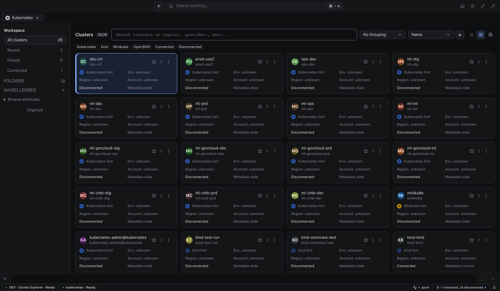
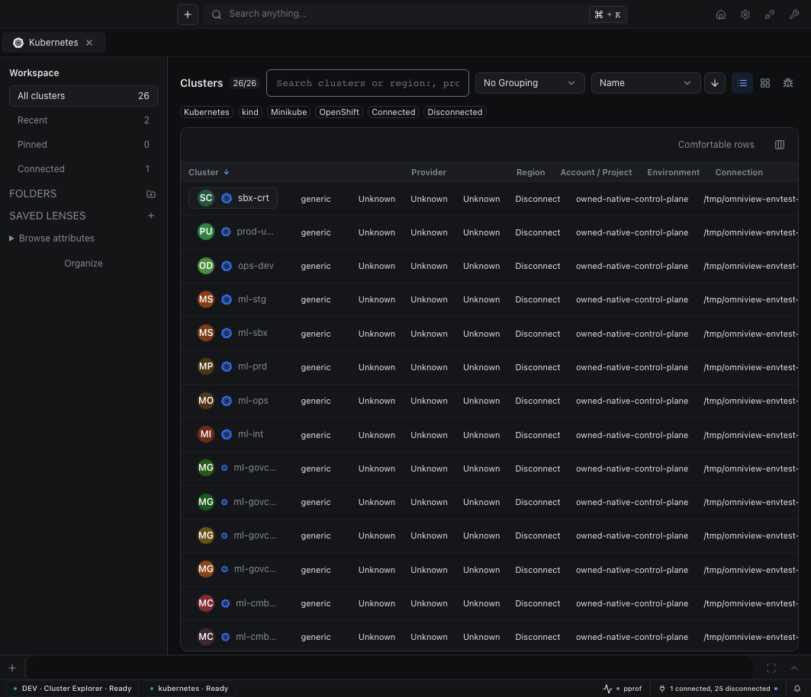
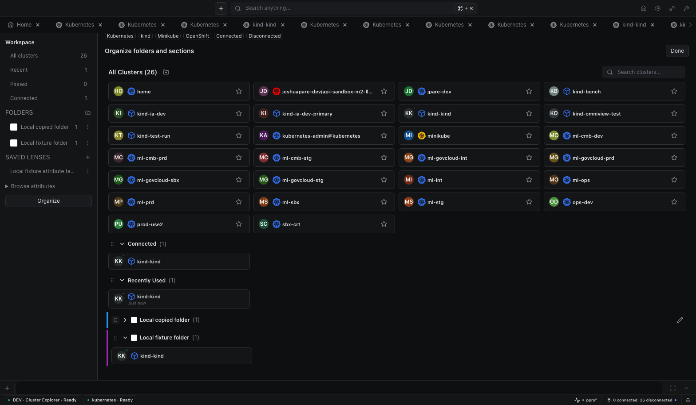

# Kubernetes 0.16.0

## Activity and notifications

- Follow deployment, StatefulSet, and DaemonSet rollouts through durable activity progress, completion, and failures.
- Track node actions, including drain progress, through the same host activity surface.
- Send plugin-owned connection warnings, clipboard failures, and folder updates through structured notifications without duplicating runtime lifecycle errors.
- Keep the keyboard-first cluster explorer, saved organization, shared preferences, and recent-history behavior from the latest main branch.

## Cluster explorer

Open clusters directly from Cards or Table, then use the independent action menu for Preview, full cluster Settings, or another tab or window. Search focuses immediately and supports free text, keyed completion, keyboard result selection, and Enter to open. Completion owns arrow keys while its popup is open; otherwise arrow keys select results. Long names retain full accessible names and tooltips without changing card height. Opaque IDs containing colons or slashes remain literal identifiers; quote them when searching.

Actual running development IDE, not a mockup or packaged-desktop capture. All 26 context aliases point to one owned real Kubernetes API and etcd, with four namespaces, zero Nodes, and no scheduler. Cloud-like names and configured hints do not establish cloud connectivity, production ownership, or workload health.

### Search facts without inventing health

- Search `region:`, `provider:`, `env:`, `account:`, `status:`, `tag:`, and available attribute keys. Repeated values for one key match any value; different keys must all match. Unknown keys and unfinished quotes show diagnostics instead of silently widening results.
- Keep provider, account, project, region, and environment provenance visible. Explicit user tags take precedence over metadata and configured label/data hints. Mutable configuration is a labeled hint, not verified ownership; names never establish production or local facts.
- Share scope, query, facets, grouping, and sort across Cards, Table, Debug, and Organize. Table retains available project and account identity. Debug distinguishes connection readiness, metadata freshness, and unknown workload health.

Same owned real-API fixture. This table is not a cloud-fleet or workload-health report.

### Organize once, keep it across windows

- Create folders with preset icons, colors, existing custom images, manual membership, and automatic rules. Effective membership is the deduplicated union of manual assignments and rule matches; removing a manual assignment does not suppress an automatic match.
- Copy cluster membership into folders by dragging from Organize to the sidebar. Explicit menu actions provide keyboard alternatives. Cancelled drags and drops outside valid targets leave membership unchanged.
- Browse or drop named PNG, JPEG, or WebP images up to 5 MiB. Both paths validate and normalize images to PNG within 128×128 before profile-backed storage. SVG import is rejected. Uploading a named image immediately saves it to the reusable library, independently of the folder dialog's Save or Cancel. Removing a library image preserves embedded images on folders already displaying it.
- Reorder and collapse sections without losing collapse state. Save, rename, replace, apply, reorder, and delete lenses containing query, facets, scope, grouping, sort direction, and view.
- Persist folders, raster assets, lenses, section state, and the shared 100-entry recent history through backend plugin data, rather than depending on one browser window.

Owned verification folders and lens before cleanup. All aliases still target the same local API; this is not evidence of multiple cloud clusters.

### Shared recent history

A ready cluster resource route records each newly mounted view once, including homepage, explorer, launcher, tabs, and windows. Nested resource navigation does not add accesses. Reconnecting or opening another ready view does. Failed connections, failed window creation, and connect-only actions do not add accesses. Opening the same route without mounting a new connected view does not add an access.

Recent recording starts immediately when the ready view mounts, without waiting for folder, lens, or image queries. Rapid folder moves use the latest stored section order and preserve collapse state. Cluster Settings and its Metrics test availability use the same runtime connection readiness as the explorer, not refresh timestamps.

## Exercised evidence and limits

The [evidence index](../images/cluster-explorer/index.json) contains twelve final Cards/Table/Debug screenshots at 360, 768, 1063, and 1568 pixels, plus organization, search, and settled API captures. The [original live summary](../images/cluster-explorer/live-summary.json) records direct opening, keyboard navigation, opaque IDs, new-tab handoff, manual/rule membership, raster browse/drop/reuse/removal, drag-copy/cancellation/outside-target drops, order/collapse, lenses, global recents, homepage, launcher, cleanup, nine themes, five text scales, and both densities.

[Before](../images/cluster-explorer/pre-restart.json) and [after](../images/cluster-explorer/post-restart.json) restart snapshots preserve all five backend keys exactly, including folder rules and images, lenses, section state, and recent history. [Responsive measurements](../images/cluster-explorer/responsive.json) record no document overflow at all four widths.

Supplemental [actual-hook evidence](../images/cluster-explorer/atomic-hook-summary.json) used two independent contexts and query clients against the real served `usePluginData` hook. Ten functional-update rounds produced 20 increments while retaining unrelated nested data; literal replacement, on-disk equality, and deletion also passed. Its [screenshot](../images/cluster-explorer/actual-hook-owned-fixture.png) shows a temporary verification overlay, not production explorer UI. No backend write failure was induced.

Native OS window creation, OS dialogs, packaged-desktop behavior, and cloud/workload health were not proved. The API fixture has no Nodes or scheduler. These source-cohort captures do not by themselves prove registry-cohort release packaging.

## Compatibility and release ordering

**Requires Omniview 0.30.0 or newer.** This release combines activity with the cluster explorer and uses matching runtime/Vite 0.30.0, Base UI 0.14.0, and Editors 6.1.8. The host/runtime cohort provides activity, structured notifications, plugin-data snapshots, and compare-and-swap bindings. Publish matching npm packages before the registry install and frozen-lockfile packaging gate. Publish the compatible desktop before this plugin; npm publication alone is not a desktop release. Marketplace publishing enforces host 0.30.0 as the minimum.

The explorer evidence above describes its earlier source and 0.29.0 packaging cohorts. It is not verification of this integrated activity release.

Standalone artifacts use published SDK `v0.15.0` and its compatible grpc-go fork for activity streams and completed-source handling. Final integrated Go tests, UI tests, type checks, lint, and five-platform packaging remain release gates; earlier explorer captures do not establish those results.
