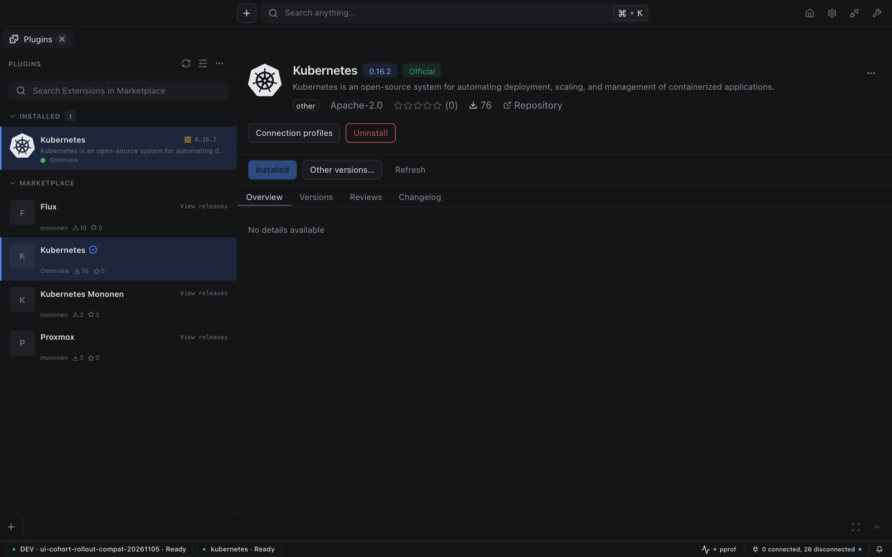
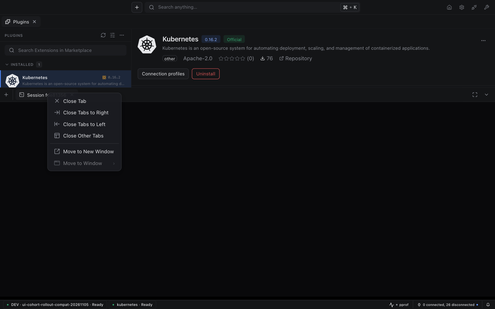

# Kubernetes 0.16.2

## Matching UI dependency cohort

- Update Base UI to 0.15.0 and Editors to 6.2.0.
- Use the matching Omniview runtime and Vite plugin 0.30.2 dependency cohort, whose Base UI peer supports 0.15.0.
- Preserve the activity, cluster explorer, and production notification behavior from 0.16.1. This release does not adopt additional metrics features.

### Related changes

- [Kubernetes dependency cohort #213](https://github.com/omniviewdev/omniview-plugin-kubernetes/pull/213).
- Shared desktop geometry: [Base UI #112](https://github.com/omniviewdev/ui/pull/112) and [host #406](https://github.com/omniviewdev/omniview/pull/406).
- Standalone shared metrics entry: [Base UI #113](https://github.com/omniviewdev/ui/pull/113).

## Compatibility

Requires Omniview 0.30.2 or newer. Upgrade the desktop before installing this plugin. Runtime releases with a Base UI `~0.14.0` peer are incompatible with Base UI 0.15.0; workspace links are not proof of registry compatibility.

## Verification

The independent frontend passed a strict frozen install, production build, and runtime-import audit against published npm packages. The UI suite passed 197 files and 1,717 tests (one file and three tests skipped); lint reported no errors. Native packaging produced a Darwin arm64 archive with the new cohort.

In an isolated omniview-dev workspace, Kubernetes 0.16.2 reached Ready and rendered the cluster explorer. The shared grouping Select changed to Provider, and the host's shared metrics module was available.

## Before and after in the IDE

Before captures show the reported UI. After captures show Kubernetes 0.16.2 in the isolated development IDE, not a packaged desktop. Viewport and plugin inventory differ; these comparisons demonstrate the coordinated global styling, not a Kubernetes-specific redesign.

### Plugin details

| Before | After |
| --- | --- |
|  |  |

### Terminal tab menu

| Before | After |
| --- | --- |
|  |  |
